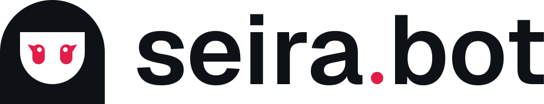
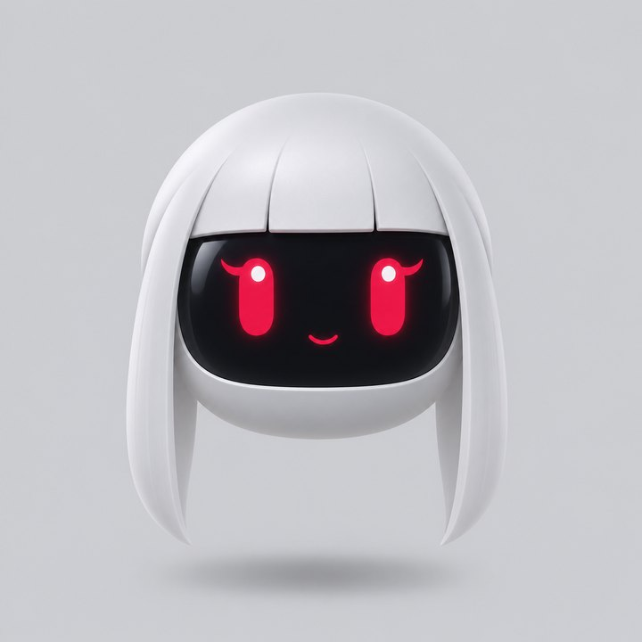
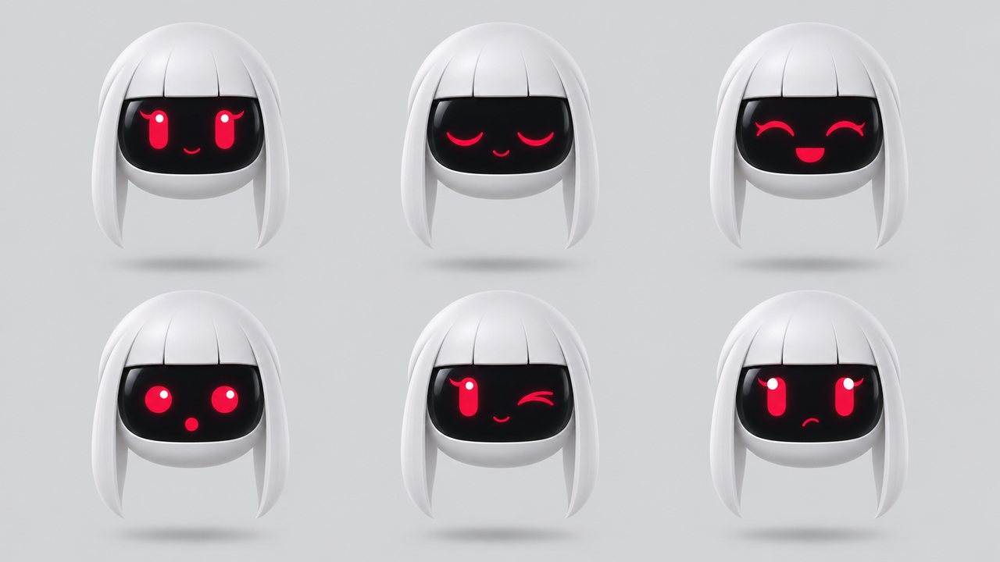
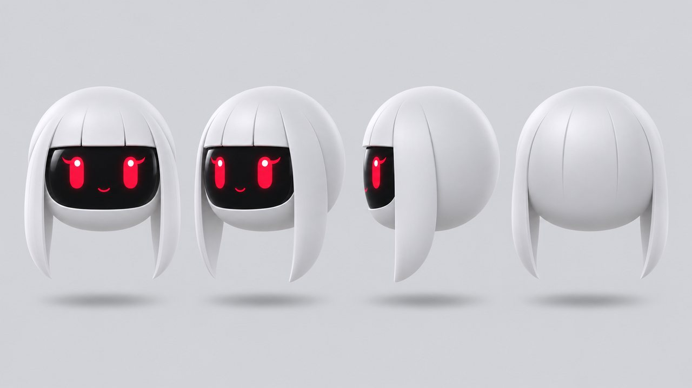
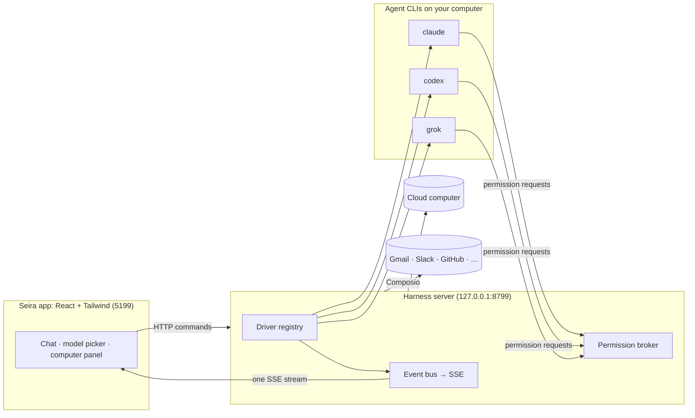

<div align="center">

<picture>
  <source media="(prefers-color-scheme: dark)" srcset="docs/assets/brand/seira-lockup-reversed.svg">
  
</picture>

<br>
<br>

**A team of AI agents in one chat app, with Seira at your side.**



Each bot in the sidebar is a real agent with its own personality, model, computer, and connected apps.<br>
Talk to your bots like contacts. Watch them work. Approve the steps that matter.

[](LICENSE)


[](https://github.com/milind-soni/OpenMausBot)

</div>

---

## Meet Seira

Seira is the face of this project: a small companion bot that floats next to your chats.
Seira has a white matte head, silver hair panels, and a black visor screen.
The face lives on that screen, so Seira can blink, smile, wink, and think while your agents work.

<p align="center">
  
</p>

<details>
<summary>Turnaround: front, three-quarter, side, and back</summary>
<br>
<p align="center">
  
</p>
</details>

| Color | Hex | Use |
|---|---|---|
| Ink | `#0E1116` | Head and wordmark on light backgrounds |
| Signal red | `#E11D48` | Eyes, and the dot in seira.bot |
| Mist | `#E9ECEF` | Head on dark backgrounds |

The logo files for light and dark backgrounds are in [`docs/assets/brand/`](docs/assets/brand/).

## Why Seira

- **Bring your own agents.** Bots run on the `claude`, `codex`, and `grok` CLIs on your computer.
  They use the logins and plans that you already have. There is no new account and no proxy in the middle.
  To use a custom CLI build, set it in **Settings → Engines**.
- **Local first.** One small harness server on `127.0.0.1` owns every agent process.
  Transcripts, keys, and events stay on your computer.
- **Agents with hands.** A bot can use a cloud Linux desktop, an isolated local VM, or your own computer after you opt in.
  It can also use more than 500 apps through Composio.
- **You stay in control.** Shell commands, file edits, and questions show as cards in the chat.
  You allow or deny each one.

## Features

| Feature | What you get |
|---|---|
| **A model per bot** | Pick Claude or Codex models for each bot from one model picker. Change the model in the middle of a conversation. |
| **A computer per bot** | Open the Computer panel to start the bot's cloud desktop. Watch a live preview, or take over in your browser. |
| **Approval cards** | A permission broker turns each risky action into a card: Allow, Deny, or answer in the chat. |
| **Connected apps** | Connect Gmail, Slack, GitHub, Notion, Linear, and hundreds more through Composio. Sign in once, and every bot can use them. |
| **Channels** | Keep Work, Personal, and each project apart. Each channel has its own transcript, instructions, work folder, and bot roster. |
| **Triggers** | Tell a bot "every weekday at 9, summarize my inbox". Schedules and webhooks start bots while you do other work. |
| **Voice** | Listen to replies, or call a bot. Voices come from ElevenLabs, Fish Audio, xAI, built-in Mac voices, or a local Chatterbox server. |
| **Teams** | Install a full team from one Markdown file. Share a bot or a department as a folder. |
| **MCP server** | Control your bots from Claude Desktop, Cursor, or another MCP client. See [docs/mcp-server.md](docs/mcp-server.md). |
| **Scripts and CI** | Start a team from the command line, wait for the result, and export what it made. See [docs/headless-cli.md](docs/headless-cli.md). |

## How it works

Seira runs as two processes.
The app sends typed commands over HTTP and reads one event stream (SSE).
The harness server owns every agent process.
It changes the protocol of each provider into one event stream, and logs each thread as NDJSON.



| Layer | Path | What it does |
|---|---|---|
| Drivers | [`server/drivers/`](server/drivers/) | One driver for each provider: Claude, Codex, and Grok over their local CLIs, plus a cloud-computer agent. An unknown driver shows as "unavailable" and does not stop the other bots. |
| Harness | [`server/harness/`](server/harness/) | The registry that turns configs into live bots, and the event bus that every client reads. |
| API | [`server/index.ts`](server/index.ts) | Bots, turns, approvals, models, computers, connectors, and config over HTTP and SSE. |
| Voice | [`server/tts/`](server/tts/) | Speech for replies and calls. Cloud keys stay on the harness server. |
| App | [`src/`](src/) | The chat app. One store from the server, one reducer, and no transport in the client. |
| Desktop | [`electron/`](electron/) | The shells for macOS, Windows, and Ubuntu, with the harness server inside. |

## Quick start

Seira has no packaged release yet. Build it from source.

You need:

- macOS, Windows, or Ubuntu 24.04 x64.
- Node.js 24 or later, and pnpm 10.
- At least one agent CLI, installed and signed in: [`claude`](https://claude.com/claude-code), [`codex`](https://github.com/openai/codex), or [`grok`](https://x.ai/cli).
  The model picker finds them automatically.

Run each `dev` command in its own terminal:

```sh
git clone https://github.com/seira-bot/seira.git && cd seira
pnpm install

pnpm dev:server    # harness server on 127.0.0.1:8799
pnpm dev           # app on http://127.0.0.1:5199
pnpm dev:desktop   # Electron shell; keep the two commands above running
```

### Optional keys

Local chat works without these keys.
To turn on an integration, paste its key in **App Settings** (the gear at the bottom of the sidebar).

| Key | What it turns on | Where to get it |
|---|---|---|
| Composio project key (`ak_…`) | Gmail, GitHub, Slack, Notion, and other apps for your bots | [docs/composio.md](docs/composio.md) |
| Boat API key | An isolated remote Linux computer with a desktop and a terminal for each bot | [Boat API keys](https://docs.boat.dev/api-keys) |
| ElevenLabs key | Spoken replies and calls | [ElevenLabs API keys](https://elevenlabs.io/app/settings/api-keys) |
| Fish Audio key | Spoken replies and calls with Fish Audio voices | [Fish Audio API keys](https://fish.audio/app/api-keys/) |

Composio and Boat are third-party services with their own accounts and terms.
Boat is a paid service after its trial, and a cloud computer can cost money.

### Check and build

```sh
pnpm typecheck       # app and server
pnpm test            # unit, driver, API, and desktop tests
pnpm build           # typecheck and production build
pnpm check:electron  # syntax check of the Electron files
```

### Package the desktop app

```sh
pnpm package:mac     # macOS: DMG and ZIP (needs Swift and Xcode tools)
pnpm package:win     # Windows: installer and ZIP
pnpm package:linux   # Ubuntu x64: .deb, AppImage, and the verified Cua runtime
```

> [!WARNING]
> Do not publish a packaged build yet. The app id and the update source are Seira's,
> but the product name, the installer names, and the Linux install folder still say OpenMausBot,
> so a Seira install can replace an OpenMausBot install on Linux
> (see [Upstream names in the code](#upstream-names-in-the-code)).
> Never upload a Seira build to the OpenMausBot release repository.

<details>
<summary>Desktop support for each system</summary>
<br>

| Capability | macOS | Windows x64 | Ubuntu 24.04 Xorg | Ubuntu 24.04 Wayland |
|---|---|---|---|---|
| Packaged app, harness server inside, local agent CLIs | Supported | Supported | Beta | Beta |
| Composio and Boat cloud computers | Supported | Supported | Beta | Beta |
| Preview of the local screen | Supported | Not available | Beta | Beta |
| Bot control of this computer | Supported | Supported | Beta, after you opt in | Off for safety |
| Dictation on the device | Supported | Not available | Planned | Planned |
| Dictation and calls through Fish Audio | Not used | Supported | Supported | Supported |

See [docs/linux-desktop.md](docs/linux-desktop.md) and [docs/computer-use-integration.md](docs/computer-use-integration.md).

</details>

## Upstream names in the code

Seira started from OpenMausBot 0.1.169 on 18 November 2026.
These names already belong to Seira:

| Where | Name today |
|---|---|
| Desktop app id | `bot.seira.app` |
| Update source of packaged builds | The `seira-bot/seira` releases on GitHub |
| Update check of a server | The `seira-bot/seira` releases and stable channel on GitHub |

Seira has no release yet, so there is nothing to update to.

Some names in the code and in the docs still come from upstream:

| Where | Name today |
|---|---|
| npm package and Linux package | `openmausbot` |
| Data folder | `~/.openmausbot` |
| Environment variables | `OMB_PORT`, `OMB_UI_PORT`, `OMB_WEBHOOK_PORT` |
| Product name, installer files, Linux install folder | `OpenMausBot`, `OpenMausBot-<version>-…`, `/opt/OpenMausBot` |
| Server image, installers, and update scripts in `deploy/` | `ghcr.io/milind-soni/openmausbot` and the upstream repository |
| Files the app reads from GitHub | Announcements, model list, team library, and browser engine downloads, all from upstream repositories |
| Cloud and website addresses | `openmausbot.com` and its subdomains |
| Text in the app and in the docs | OpenMausBot, MausBot |

Use these names as they are until the code changes.
Do not install the `openmausbot` npm package to get Seira. That package is the upstream app.

## Privacy

A Seira build sends no analytics.
The code can send them, but only to a PostHog project whose key you give when you build the app.
They are anonymous and never include keys, names, addresses, or conversations.
[docs/analytics.md](docs/analytics.md) lists each event and each property.

> [!IMPORTANT]
> This repository has no analytics key.
> A build made without `VITE_SEIRA_POSTHOG_TOKEN` has no analytics switch in Settings and sends nothing.
> A build made with a key sends analytics until you turn off **Settings → General → Usage analytics**.

## Documentation

The guides in [`docs/`](docs/) and [`apps/docs/`](apps/docs/) come from upstream.
They still say OpenMausBot in some places.

| Topic | Guide |
|---|---|
| Your own engines (ACP CLIs, OpenAI-compatible endpoints) | [docs/custom-engines.md](docs/custom-engines.md) |
| Your own MCP tool servers | [docs/custom-mcp-servers.md](docs/custom-mcp-servers.md) |
| Self-hosting on a server | [docs/self-hosting.md](docs/self-hosting.md), [docs/deploy-vps.md](docs/deploy-vps.md) |
| Voice | [docs/voice-mode.md](docs/voice-mode.md) |
| Team sharing | [docs/team-sharing.md](docs/team-sharing.md) |
| Routing with a decision model | [docs/decision-model.md](docs/decision-model.md) |
| Feature switches | [docs/feature-flags.md](docs/feature-flags.md) |
| Other model providers | [apps/docs/…/model-providers.mdx](apps/docs/content/docs/providers/model-providers.mdx) |

## Contributing

Issues and pull requests are welcome.
[CONTRIBUTING.md](CONTRIBUTING.md) explains how a change lands, the [code guide](docs/contributing.md) holds the code rules,
and [DESIGN.md](DESIGN.md) holds the design rules. The last two come from upstream, so read "OpenMausBot" as "Seira".

The driver contract in [`server/contracts.ts`](server/contracts.ts) is small.
To add a provider, add one file in [`server/drivers/`](server/drivers/) and register it with one line.

Do not post a security problem in public. Report it through [private vulnerability reporting](https://github.com/seira-bot/seira/security/advisories/new).
If the problem is also in OpenMausBot, report it upstream too, as [SECURITY.md](SECURITY.md) describes.

## License and credits

Seira is a fork of [OpenMausBot](https://github.com/milind-soni/OpenMausBot) by Milind Soni and the OpenMausBot contributors.
Their work is the base of this project. Thank you.

- The code is under the [Apache License 2.0](LICENSE). Read [NOTICE](NOTICE) for the upstream copyright and third-party credits.
- [`enterprise/`](enterprise/) is source-available under [its own license](enterprise/LICENSE), not Apache 2.0.
  Remove that folder to get the open-source edition. [LICENSING.md](LICENSING.md) gives the details.
- The packaged Cua Driver parts keep their own licenses. See [`third_party/cua-driver/`](third_party/cua-driver/).
- The Apache License does not give rights to the Seira name, logo, or mascot (section 6).

Seira is an independent project. It is not affiliated with or endorsed by the OpenMausBot maintainer,
Anthropic, OpenAI, or xAI. Claude, Codex, and Grok are trademarks of their owners.
