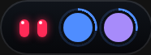
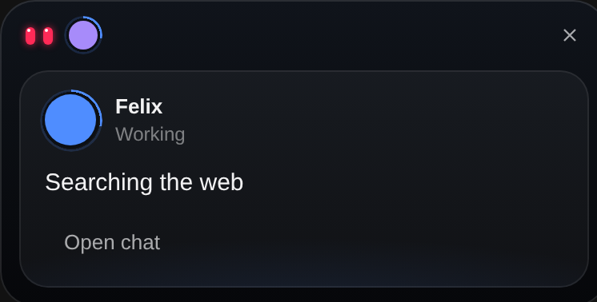
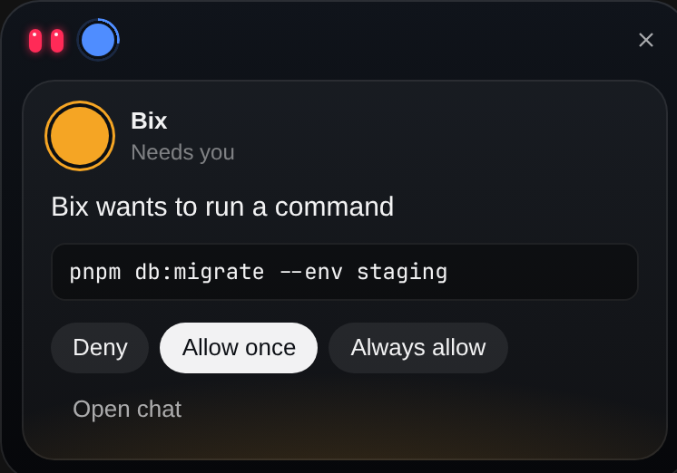
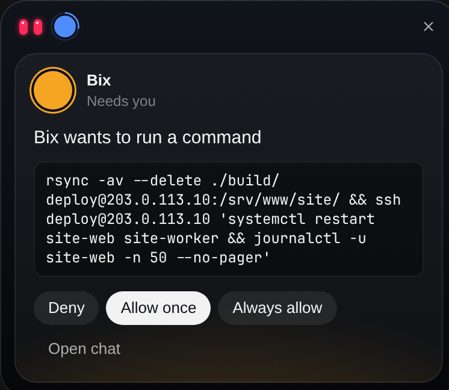
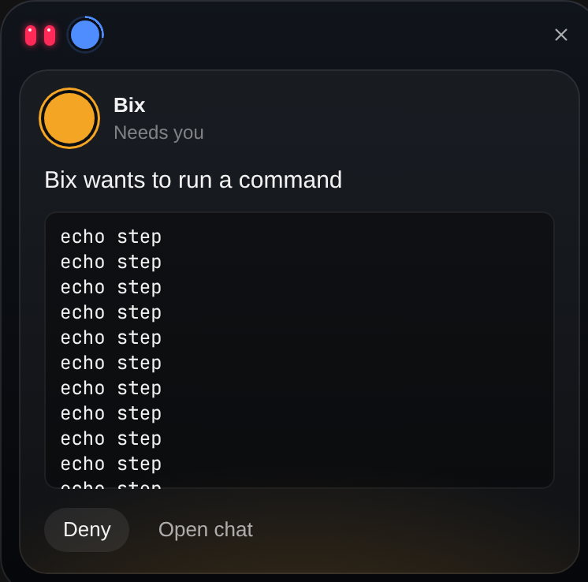
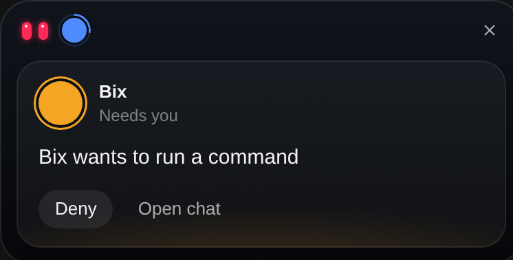
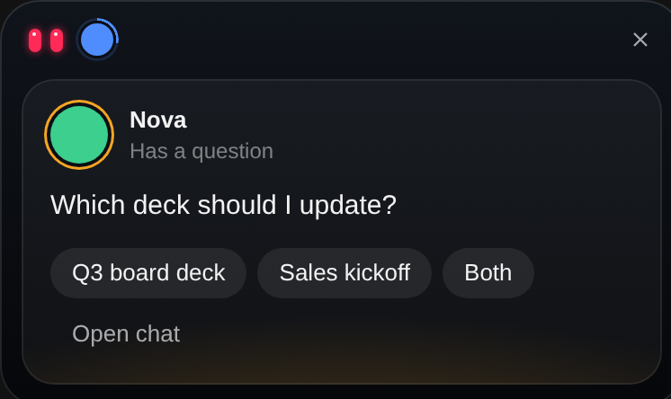
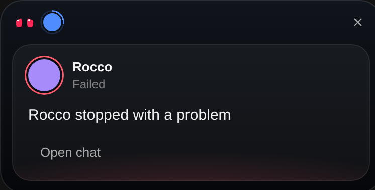
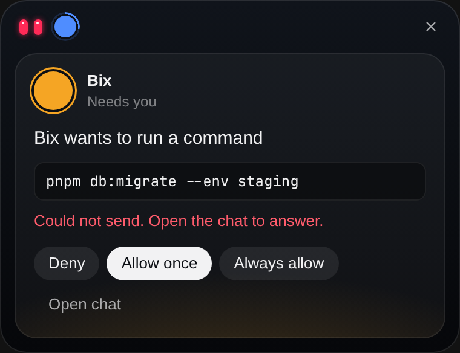

# Glance (the visor at the top of the screen)

Glance shows the bots of the place in the main window that work, need the
person, failed, or just finished. On macOS, Windows and Linux X11 it is a small
never-focused visor at the top centre of the primary display. On Linux Wayland
an app cannot place or pin a window, so Glance is a tray icon there.

Window placement, always-on-top over full-screen apps, focus, and the tray of
each desktop are operating-system behaviour: the control surface cannot drive
them, so this is not in the map in [README](README.md). Verify them by hand on
a packaged build, exactly as below.

## Floor: automated checks

```sh
node --test electron/glance-*.node-test.mjs electron/preload-contract.node-test.mjs electron/desktop-prefs.node-test.mjs
pnpm exec vitest run src/state/glance-feed.test.ts src/state/use-glance.test.ts electron/menu.test.mjs shared/app-features.test.ts --maxWorkers=4
pnpm typecheck && pnpm lint && pnpm i18n:check
```

They prove:

- the feed check: limits, types, avatars only from the app's own attachments,
  and feeds from any sender other than the main window's main frame ignored;
- the order of bots (needs you or a question, then failed, then the longest
  working, then finished), at most four avatars, hidden when no bot is active;
- "finished" for 4 s after a bot stops working, and no old failure at start;
- opening by itself for a new approval or question, but not while the main
  window has focus or Glance is off;
- an answer from the visor checked against the current card, sent to the page,
  and a failed or late answer reported back as an error;
- Allow once and Always allow offered only while the whole text of what the
  approval covers is in view without scrolling; otherwise only Deny and Open
  chat;
- the window flags (never focusable, shown inactive, on top of full-screen
  apps), the tray rows, the View menu item and the saved choice;
- the page feed: idle bots left out, no raw command text, and each answer sent
  through the chat card's own path.

## Evidence: the visor in each state

```sh
node scripts/glance-evidence.mjs [path to Chrome or Chromium]
```

The script renders the visor page in headless Chrome with views from the real
model, at the size the visor asks its window for, and writes one picture per
state to [evidence/glance](evidence/glance/). It prints each picture's size and
visible text.

| State | Picture |
|-------|---------|
| Working, compact |  |
| Six bots working, at most four avatars |  |
| Peek |  |
| Card of a working bot |  |
| Approval with what it covers |  |
| Long approval text, whole and scrollable |  |
| Approval text that needs scrolling |  |
| Approval without that text |  |
| Question |  |
| Failed |  |
| Finished |  |
| Answer not sent |  |

The checks and pictures do not prove the real position on each display, the
visor over a full-screen app or another Space, the notch on a MacBook, or the
tray on each Linux desktop.

## Setup

- A packaged build of the branch installed beside, never over, the installed
  Seira. Never touch the installed app or its data folder.
- Launch with `SEIRA_DATA_DIR` and `SEIRA_PORT` set to a test folder and port,
  with a bot that can run a long task and ask for approval.

## Manual checks

| Check | Steps | Expected |
|-------|-------|----------|
| Shows while a bot works | Ask a bot for a long task, then switch to another app. | The visor appears at the top centre with Seira's eyes and the bot's avatar in a working ring. It does not take focus: typing still goes to the other app. |
| Hidden when idle | Wait until every bot is idle. | The visor shows "finished" for about 4 s, then hides. |
| Peek | Rest the pointer on the visor. | After a short moment one line shows what the bot does, in plain words. |
| Open | Click the visor. | The card of the top bot opens: needs you first, then failed, then the longest working. |
| Ask opens by itself | Switch to another app, then make a bot ask for approval. | The visor opens on the card by itself, and focus stays in the other app. With the Seira window in front, the visor does not open by itself. |
| Answer | Pick Allow once, Always allow, Deny, or a question option. | The chat shows the same answer as when the card's own button is used. |
| Answer fails | Stop the test server, then pick an answer. | The card stays and shows a short error with Open chat. |
| Open chat | Click Open chat. | The Seira window comes to the front on that bot's chat. |
| Close | Open a card without an ask, then move the pointer away for 1 s, or click Close. | The visor goes back to compact. A card with an ask stays open. |
| Turn off | View → Glance, then restart the app. | Glance stays off until it is turned on again. |
| Wayland | Run the same steps in a Linux Wayland session. | No visor. A Glance tray icon shows while a bot is active, with one row per bot; a row opens that chat. |
| Reduced motion | Turn on reduced motion in the system, then repeat "Shows while a bot works". | Nothing moves. |
